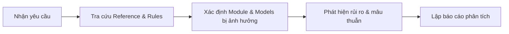

# Command: /analyze

## 1. Mục đích
Phân tích yêu cầu nghiệp vụ mới hoặc sự cố kỹ thuật, xác định phạm vi ảnh hưởng (impact analysis), bóc tách các module liên quan giữa Frontend Next.js và Backend FastAPI/MongoDB, phát hiện mâu thuẫn hoặc thông tin còn thiếu.

## 2. Input
- Yêu cầu người dùng (User Request / Feature Request / Bug Report).
- Danh sách file hoặc module nghi vấn (nếu có).

## 3. Quy trình thực hiện (5 bước)

1. **Tra cứu quy chuẩn:**  
   Đọc [`architecture.md`](file:///d:/Projects/ncf-sports-recommender/.claude/rules/architecture.md) và [`api-contracts.md`](file:///d:/Projects/ncf-sports-recommender/.claude/reference/api-contracts.md).
2. **Kiểm tra hiện trạng:**  
   Grep hoặc xem mã nguồn thực tế tại `backend/app/` và `frontend/src/modules/` tương ứng.
3. **Phân loại tác động:**  
   - Frontend: Trang/Component nào cần sửa đổi? Có ảnh hưởng Server/Client state không?
   - Backend: Cần thêm API endpoint hay thay đổi schema Beanie Model không?
   - ML/Recommender: Có ảnh hưởng đến vector nhúng NCF hay dữ liệu tương tác không?
4. **Phát hiện lỗ hổng:**  
   Chỉ rõ các trường dữ liệu thiếu, rủi ro bảo mật (auth/role) và nguy cơ trùng lặp logic.
5. **Đề xuất giải pháp:**  
   Đưa ra 1-2 phương án kiến trúc tối ưu (khuyến khích phương án đơn giản, sát thực tế).

## 4. Output mong đợi
Bản báo cáo phân tích gồm:
- **Tóm tắt yêu cầu (Executive Summary)**
- **Các thành phần bị ảnh hưởng (Affected Components Table)**
- **Phân tích rủi ro & giả định (Risks & Assumptions)**
- **Khuyến nghị kiến trúc (Architectural Recommendations)**

## 5. Tiêu chí hoàn thành (Definition of Done)
- Phân biệt rõ ràng giữa thông tin đã kiểm chứng trong code và giả định suy đoán.
- Có đường dẫn link cụ thể tới các file mã nguồn liên quan.
- Không tự ý sinh code triển khai trong bước phân tích này.
