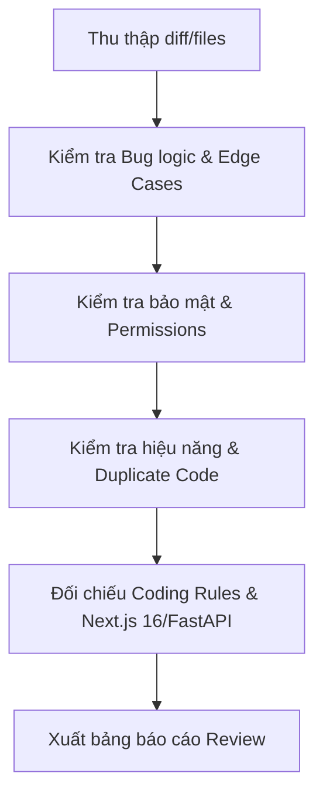

# Command: /review

## 1. Mục đích
Rà soát chất lượng mã nguồn (Code Review), kiểm tra tính an toàn, bảo mật, hiệu năng, phát hiện code trùng lặp và đối chiếu với các nguyên tắc tại `.claude/rules/`.

## 2. Input
- File hoặc pull request / diff cần đánh giá (mặc định là các file đã sửa đổi gần nhất qua `git status`).

## 3. Quy trình thực hiện (5 bước)

1. **Bug Logic & Tính toàn vẹn:**
   - Xử lý bất đồng bộ (`async/await`) đã đầy đủ chưa? Có nguy cơ race condition không?
   - Dữ liệu `null` hoặc `undefined` có được bắt an toàn không?
2. **Kiểm tra bảo mật:**
   - Có lộ mật khẩu, API key, JWT token hoặc thông tin nhạy cảm không?
   - Endpoint backend có kiểm tra quyền Admin/User hợp lệ không?
3. **Hiệu năng & Trùng lặp:**
   - Có vòng lặp N+1 queries trong Beanie/MongoDB không?
   - Có tính toán nặng chạy trực tiếp trên luồng chính của client không?
4. **Đối chiếu quy tắc dự án:**
   - Đã tuân thủ Next.js 16 (`await params`) chưa?
   - Các thẻ `` đã có `onError` fallback chưa?
   - API gợi ý đã qua `_filter_duplicate_recs` chưa?
5. **Tổng kết đánh giá:**
   - Phân loại: **Critical (Bắt buộc sửa)**, **Warning (Cảnh báo)**, **Suggestion (Đề xuất tối ưu)**.

## 4. Output mong đợi
Báo cáo Code Review chi tiết theo từng file, kèm giải pháp khắc phục bằng mã nguồn cụ thể.

## 5. Tiêu chí hoàn thành (Definition of Done)
- Phải chỉ rõ dòng code (line number) và file liên quan.
- Không báo cáo chung chung. Mọi góp ý đều phải có lý do kỹ thuật rõ ràng.
