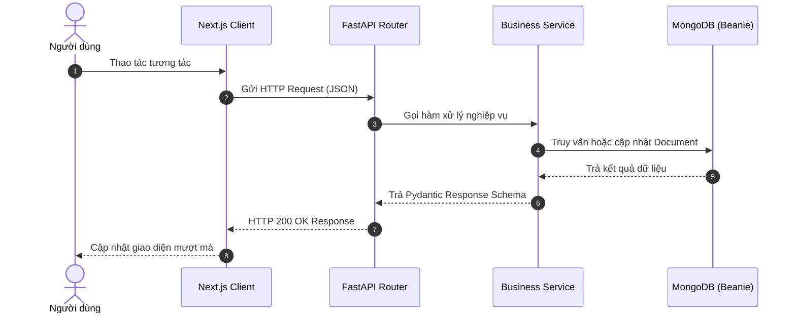

# Feature Implementation Plan: [Tên Tính Năng]

> **Trạng thái:** `DRAFT` | `APPROVED` | `IN_PROGRESS` | `COMPLETED`  
> **Tác giả:** [Tên người lập hoặc AI Agent]  
> **Ngày lập:** [YYYY-MM-DD]  
> **Module liên quan:** [Frontend/Backend/ML/Database]

---

## 1. Business Objective (Mục tiêu nghiệp vụ)
Mô tả lý do tại sao tính năng này cần thiết và giá trị cụ thể mang lại cho người dùng hoặc nền tảng KADY Sports (ví dụ: tăng trải nghiệm người dùng, cải thiện chỉ số gợi ý NCF, nâng cao độ chính xác tồn kho).

## 2. Problem Statement (Mô tả bài toán)
Tình trạng hiện tại của hệ thống đang gặp hạn chế gì? Những trở ngại mà người dùng hoặc hệ thống đang gặp phải?

## 3. User Stories
- **US-01:** Là một *[Khách vãng lai / Khách đăng nhập / Quản trị viên]*, tôi muốn *[Hành động]* để có thể *[Lợi ích mang lại]*.
- **US-02:** ...

## 4. Acceptance Criteria (Tiêu chí chấp nhận)
- [ ] **AC-01:** ...
- [ ] **AC-02:** ...
- [ ] **AC-03:** Không làm gãy luồng hoạt động hiện tại của hệ thống gợi ý NCF.

## 5. Functional Requirements (Yêu cầu chức năng)
1. **FR-01:** ...
2. **FR-02:** ...
3. **FR-03:** Xử lý các tình huống biên (Edge cases): Mạng chậm, dữ liệu rỗng, id không hợp lệ.

## 6. Non-Functional Requirements (Yêu cầu phi chức năng)
- **Hiệu năng:** Thời gian phản hồi API < 200ms đối với truy vấn MongoDB và < 500ms đối với tính toán embedding NCF.
- **Bảo mật:** Xác thực JWT token đối với các hành động nhạy cảm, validate payload bằng Pydantic.
- **Tương thích:** Đáp ứng tốt trên cả Mobile Responsive và Desktop theo chuẩn Mantine/Tailwind.

## 7. Architecture Impact (Tác động kiến trúc)
Mô tả những thay đổi về kiến trúc hệ thống (nếu có). Có cần thêm service mới trong `backend/app/services/` hay module mới trong `frontend/src/modules/` không?

## 8. Data Flow (Luồng dữ liệu)

## 9. API / Database Changes (Thay đổi API & Cơ sở dữ liệu)

### Backend Endpoint mới / cập nhật:
| Method | Endpoint | Auth | Request Body | Response Schema |
|---|---|---|---|---|
| `GET/POST` | `/api/v1/...` | `Bearer / None` | `{ ... }` | `{ ... }` |

### MongoDB Schema Changes (Beanie Document):
- **Model:** `app.models.<model_name>.<ModelClass>`
- **Fields thêm mới / thay đổi:**
  - `field_name: Optional[type] = default_value`

## 10. Affected Files and Modules (Danh sách tệp liên quan)

### Backend:
- `backend/app/schemas/...` *(Mới hoặc sửa)*
- `backend/app/models/...` *(Sửa)*
- `backend/app/services/...` *(Mới hoặc sửa)*
- `backend/app/api/v1/endpoints/...` *(Mới hoặc sửa)*

### Frontend:
- `frontend/src/shared/store/...` *(State quản lý)*
- `frontend/src/modules/<domain>/components/...` *(UI components)*
- `frontend/src/app/(public)/...` *(Next.js Pages)*

## 11. Implementation Steps (Các bước thực thi)
1. [ ] **Bước 1 (Backend Data & Logic):** Tạo/cập nhật Pydantic Schema, Document Model và Service logic.
2. [ ] **Bước 2 (Backend Endpoint):** Khai báo endpoint trong FastAPI và đăng ký router.
3. [ ] **Bước 3 (Frontend State & API):** Cập nhật Zustand store hoặc hook gọi API.
4. [ ] **Bước 4 (Frontend UI):** Hoàn thiện component giao diện với Tailwind/Mantine, gắn fallback `onError`.
5. [ ] **Bước 5 (Integration):** Kiểm thử tích hợp thông suốt luồng giữa client và server.

## 12. Testing Strategy (Chiến lược kiểm thử)
- **Unit/Integration Script:** Viết script kiểm thử độc lập tại `backend/scripts/test_<feature>.py`.
- **API Verification:** Kiểm tra mã trạng thái HTTP, định dạng dữ liệu trả về và thời gian đáp ứng.
- **UI Testing:** Kiểm tra trên giao diện thực tế (hover, click, responsive, loading skeleton).

## 13. Risks and Dependencies (Rủi ro & Phụ thuộc)
- **Rủi ro 1:** ... $\rightarrow$ *Giải pháp:* ...
- **Rủi ro 2:** ... $\rightarrow$ *Giải pháp:* ...

## 14. Definition of Done (Tiêu chuẩn hoàn thành)
- [ ] Tất cả các tiêu chí trong mục **Acceptance Criteria** đều đạt.
- [ ] Đã chạy script kiểm thử thành công, không có lỗi 500 hoặc crash.
- [ ] Không có lỗi linting trên frontend và không có warning cú pháp backend.
- [ ] Tài liệu liên quan trong `.claude/reference/` đã được đồng bộ.
