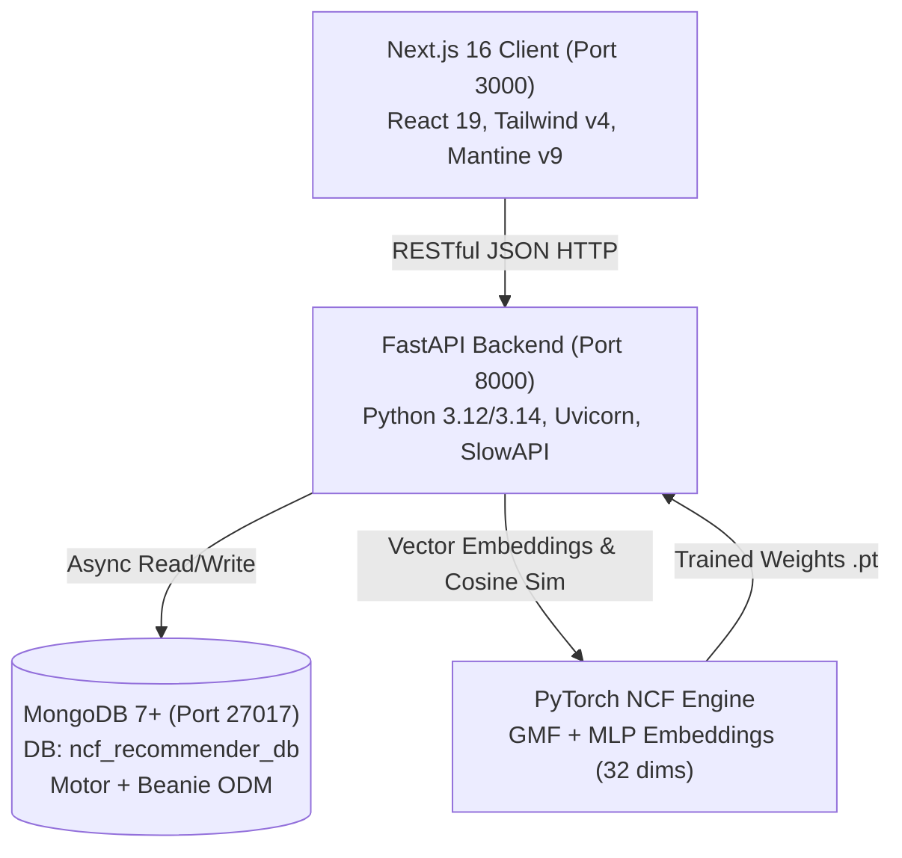

# System Architecture Reference

## 1. Kiến trúc Tổng thể (High-Level Architecture)

Hệ thống **KADY Sports Recommender** được tổ chức theo mô hình **Decoupled Client-Server Monorepo**:

---

## 2. Phân rã Trách nhiệm (Separation of Concerns)

### A. Frontend Service (`frontend/`)
- **Vai trò:** Xử lý trải nghiệm người dùng, render phía server (SSR) cho SEO danh mục thể thao, render phía client (CSR) cho các tính năng giỏ hàng, thanh toán, tương tác tài khoản và admin portal.
- **Cấu trúc Modular Clean:**
  - `modules/public/`: Các module phục vụ khách hàng (trang chủ, danh mục sản phẩm, chi tiết sản phẩm, giỏ hàng, thanh toán, tra cứu đơn hàng, trang gợi ý chuyên biệt `/goi-y`).
  - `modules/admin/`: Các module quản trị (tổng quan dashboard thống kê doanh thu, quản lý kho hàng, quản lý đơn hàng & in hóa đơn, quản lý khách hàng, banner, mã giảm giá, kiểm soát mô hình AI).
  - `modules/user/`: Bảng điều khiển cá nhân (thông tin tài khoản, danh sách yêu thích, lịch sử đơn hàng, sản phẩm gợi ý riêng).
  - `shared/`: Bộ nhớ Zustand tập trung (`cartStore`, `authStore`, `wishlistStore`), các tiện ích tính toán và components dùng chung.

### B. Backend Service (`backend/`)
- **Vai trò:** Cung cấp toàn bộ RESTful API, xác thực quyền truy cập JWT, quản lý giao dịch đơn hàng và tính toán gợi ý cá nhân hóa thời gian thực.
- **Cấu trúc 3 lớp (3-Tier Layered):**
  - **API Layer (`app/api/v1/endpoints/`):** Tiếp nhận HTTP Request, xác thực tham số qua Pydantic Schema, bắt lỗi và trả về HTTP Response.
  - **Service Layer (`app/services/`):** Xử lý nghiệp vụ logic (tính toán giảm giá voucher, trừ tồn kho, tính cosine similarity vector nhúng NCF, lọc trùng lặp sản phẩm).
  - **Data Access Layer (`app/models/`):** Các Beanie Document classes kế thừa `beanie.Document`, ánh xạ trực tiếp tới các MongoDB collections.

### C. Recommendation Engine (`backend/app/ml/` & `RecommendationService`)
- **Mô hình NCF (Neural Collaborative Filtering):**
  - Kết hợp 2 nhánh song song: **GMF** (tương tác tuyến tính nhân vô hướng ma trận embedding) và **MLP** (tương tác phi tuyến qua 4 lớp fully-connected `[64, 32, 16, 8]`).
  - Vector biểu diễn sản phẩm có số chiều: $16 \text{ (GMF)} + 16 \text{ (MLP)} = 32 \text{ chiều}$.
  - Tập tin trọng số mô hình: `backend/app/ml/saved_models/ncf_model.pt` và bản đồ ánh xạ `mappings.json`.
- **Chiến lược lai (Hybrid Fallback Pipeline):**
  - *Người dùng đã đăng nhập & có lịch sử:* Dự đoán điểm sở thích bằng mạng NCF.
  - *Ngữ cảnh giỏ hàng (Cart Cross-sell):* Tính Cosine Similarity giữa mean embedding của các món trong giỏ và toàn bộ kho sản phẩm, ưu tiên phụ kiện thể thao cùng môn.
  - *Khách vãng lai / Cold-Start:* Gợi ý dựa trên sản phẩm đang xem kết hợp điểm chất lượng (Rating $\ge 4.5$, số lượng đánh giá cao, jitter tạo độ tươi mới).
  - *Bộ lọc độc bản:* Mọi luồng đều phải qua `_filter_duplicate_recs` để không trùng ảnh và không trùng tên sản phẩm gốc.
