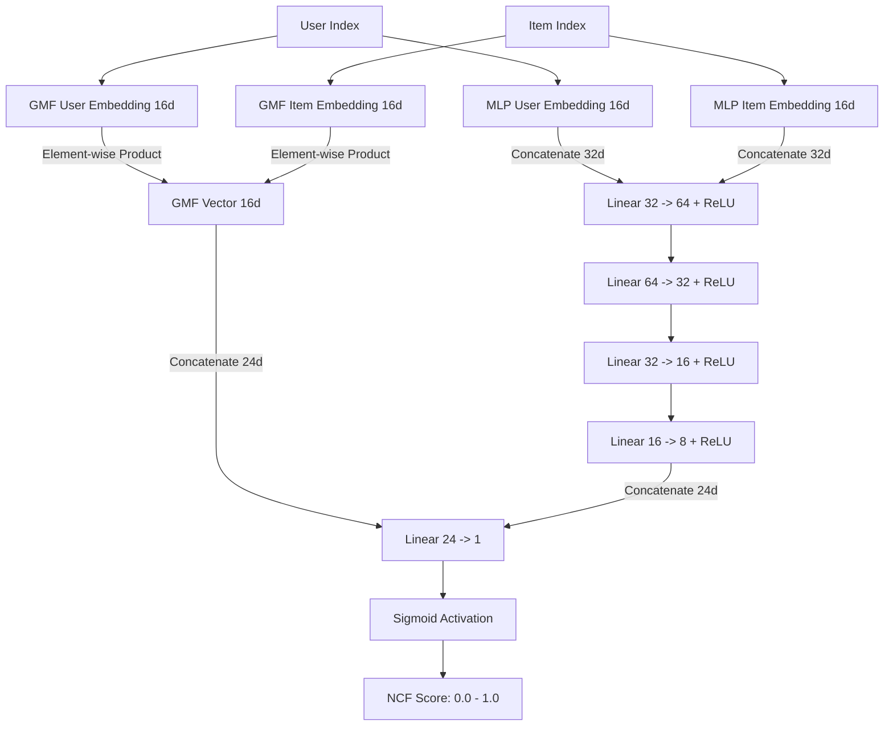
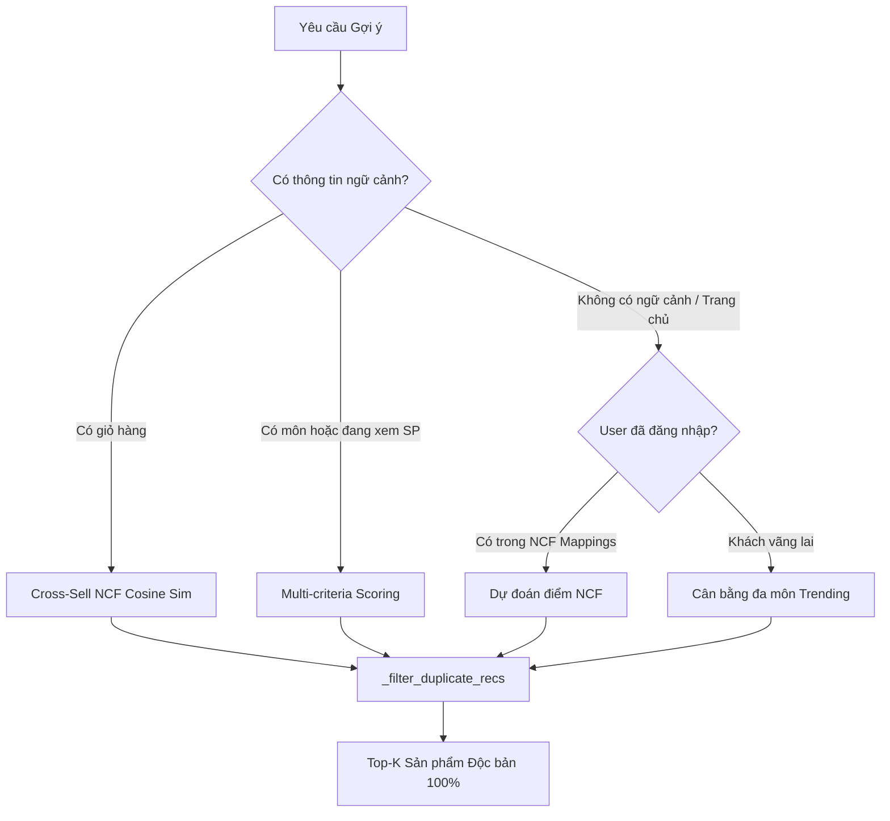

# Recommendation Pipeline & NCF Model Reference

> **Service:** `backend/app/services/recommendation_service.py`  
> **Model Definition:** `backend/app/ml/ncf_model.py`  
> **Trained Weights:** `backend/app/ml/saved_models/ncf_model.pt` + `mappings.json`

---

## 1. Kiến trúc Mô hình NCF (Neural Collaborative Filtering)

Mô hình kết hợp hai trường phái mạnh nhất của hệ thống gợi ý: **Linear Matrix Factorization (GMF)** và **Non-linear Deep Neural Network (MLP)**.

---

## 2. Các luồng gợi ý trong hệ thống

### A. Gợi ý theo Giỏ hàng (Basket Cross-sell)
1. Lấy danh sách `product_id` có trong giỏ hàng.
2. Trích xuất vector nhúng sản phẩm kết hợp:
   $$\mathbf{e}_{\text{item}} = [\mathbf{e}_{\text{GMF}} \,\|\, \mathbf{e}_{\text{MLP}}] \in \mathbb{R}^{32}$$
3. Tính vector đại diện giỏ hàng bằng trung bình cộng (Mean Pooling):
   $$\mathbf{e}_{\text{basket}} = \frac{1}{|C|} \sum_{i \in C} \mathbf{e}_i$$
4. Tính **Cosine Similarity** giữa $\mathbf{e}_{\text{basket}}$ và toàn bộ sản phẩm trong kho.
5. Loại bỏ các sản phẩm đã có trong giỏ, ưu tiên phụ kiện thể thao cùng môn bổ trợ.

### B. Gợi ý theo Ngữ cảnh Sản phẩm Đang xem (Context Cold-Start)
Áp dụng công thức chấm điểm đa tiêu chí (Multi-criteria Scoring):
$$\text{Score} = 0.6 \times \text{Rating} + 0.8 \times \min\left(1, \frac{\text{Reviews}}{20}\right) + 3.0 \times \mathbb{I}(\text{Cùng môn}) + 1.2 \times \mathbb{I}(\text{Cùng danh mục}) + 2.0 \times \text{NCF\_Sim} + \epsilon$$
*(Trong đó $\epsilon \in [-0.25, 0.25]$ là jitter ngẫu nhiên tạo độ tươi mới khi tải lại trang).*

---

## 3. Quy chuẩn Khử Trùng lặp (Deduplication Standard)

Hàm `_filter_duplicate_recs(products: List[Product], max_count: int)` đảm bảo:
1. **Khử trùng lặp URL ảnh (`seen_images`):** Nếu 2 sản phẩm có cùng link ảnh, chỉ giữ lại sản phẩm đầu tiên.
2. **Khử trùng lặp tên gốc (`seen_base_names`):** Sử dụng Regex loại bỏ các hậu tố nhân bản như ` - Mẫu \d+`, ` - V\d+` (ví dụ: *"Vớ Fox Socks Pro - Mẫu 2"* và *"Vớ Fox Socks Pro - Mẫu 3"* được nhận diện là cùng 1 dòng sản phẩm).
3. **Khử trùng lặp ID (`seen_ids`):** Đảm bảo mỗi `product_id` chỉ xuất hiện 1 lần.

---

## 4. Kỹ thuật Lấy mẫu Âm & Đánh giá Học thuật (He et al., 2017)

### A. Negative Sampling (Tỷ lệ 1:4)
Trong bài toán phản hồi ngầm (Implicit Feedback), chỉ có các hành vi tích cực được quan sát ($y_{ui} = 1.0$). Để tránh hiện tượng sụp đổ mô hình (trivial collapse) và dự đoán thiên lệch dương, hệ thống tự động sinh mẫu âm:
* Với mỗi tương tác dương $(u, i) \in \mathcal{R}_u^+$, bốc ngẫu nhiên $N = 4$ sản phẩm $j \in \mathcal{I} \setminus \mathcal{R}_u^+$ chưa từng tương tác gán nhãn $y_{uj} = 0.0$.
* Tối ưu hóa bằng hàm mất mát nhị phân Binary Cross-Entropy (BCE Loss).

### B. Leave-One-Out Evaluation Protocol (HR@10 & NDCG@10)
Đánh giá độ chính xác xếp hạng Top-10 theo giao thức chuẩn mực quốc tế:
1. Đối với mỗi người dùng có $\ge 2$ tương tác, giữ lại tương tác cuối cùng làm mẫu kiểm thử $(u, i_{\text{test}})$.
2. Lấy ngẫu nhiên $99$ sản phẩm chưa từng tương tác gán làm mẫu kiểm thử âm.
3. Cho mô hình NCF dự đoán điểm số cho danh sách 100 sản phẩm ($1$ sản phẩm thực tế $+ 99$ sản phẩm âm).
4. Xếp hạng 100 sản phẩm theo điểm dự đoán giảm dần, xác định vị trí thứ hạng $p$ của $i_{\text{test}}$:
   * **Hit Rate @ 10 (HR@10):**
     $$\text{HR@10} = \begin{cases} 1 & \text{nếu } p \le 10 \\ 0 & \text{ngược lại} \end{cases}$$
   * **Normalized Discounted Cumulative Gain @ 10 (NDCG@10):**
     $$\text{NDCG@10} = \begin{cases} \frac{1}{\log_2(p + 1)} & \text{nếu } p \le 10 \\ 0 & \text{ngược lại} \end{cases}$$

---

## 5. Tiến trình Huấn luyện Ngầm & Theo dõi Hiệu quả Trực tuyến (Online CTR)

* **Non-blocking Retrain:** Endpoint `POST /api/v1/recommendations/retrain` khởi chạy ngầm trong `asyncio.create_task()`, không làm nghẽn FastAPI Event Loop. Giao diện Admin polling tiến độ qua `GET /api/v1/recommendations/training-status` với thanh tiến trình Epoch 1..10 và giá trị Loss thời gian thực.
* **Online CTR Tracking:** Khi danh sách gợi ý hiển thị trên giao diện (Homepage, Giỏ hàng, Chi tiết), hệ thống ghi nhận `RecommendationImpression`. Khi người dùng click, sự kiện `POST /track-click` được kích hoạt để tính toán tỷ lệ nhấp chuột thực tế (**CTR = Clicks / Impressions**) và hiển thị trực quan trên Dashboard quản trị.

---

## 6. Bộ đệm Vector Nhúng Tiền Tính Toán (Pre-computed Item Embeddings Cache)

Nhằm tối ưu hóa triệt để thời gian phản hồi của API Cross-sell (`POST /api/v1/recommendations/cross-sell`), hệ thống tiền tính toán và lưu ma trận nhúng trong RAM:
1. Khi khởi động dịch vụ hoặc nạp lại mô hình, `RecommendationService` trích xuất đồng thời trọng số của GMF và MLP:
   $$\mathbf{E}_{\text{raw}} = [\mathbf{W}_{\text{GMF\_item}} \,\|\, \mathbf{W}_{\text{MLP\_item}}] \in \mathbb{R}^{N \times 32}$$
2. Ma trận được chuẩn hóa $L_2$ sẵn một lần duy nhất vào biến `self.cached_item_embeddings`:
   $$\hat{\mathbf{E}} = \text{Normalize}(\mathbf{E}_{\text{raw}}, p=2, \text{dim}=1)$$
3. Khi có yêu cầu gợi ý giỏ hàng chứa danh sách chỉ số $C$, vector đại diện giỏ hàng được tính và chuẩn hóa:
   $$\hat{\mathbf{e}}_{\text{basket}} = \text{Normalize}\left(\frac{1}{|C|} \sum_{c \in C} \hat{\mathbf{E}}_c, p=2\right)$$
4. Toàn bộ điểm tương đồng Cosine giữa giỏ hàng và kho sản phẩm được tính toán tức thời bằng phép nhân ma trận BLAS chuẩn C++/PyTorch:
   $$\mathbf{s} = \hat{\mathbf{e}}_{\text{basket}} \times \hat{\mathbf{E}}^T \in \mathbb{R}^N$$
*(Loại bỏ hoàn toàn chi phí lặp trích xuất tensor động của PyTorch, giảm độ trễ từ $150\text{ms}$ xuống dưới $5\text{ms}$).*

---

## 7. Tìm kiếm Tiếng Việt Đa trường & Mờ (Vietnamese Fuzzy & Synonym Search)

Khắc phục hạn chế của việc tìm kiếm `$regex` thông thường, tiện ích [`app.core.search_utils`](file:///d:/Projects/ncf-sports-recommender/backend/app/core/search_utils.py) cung cấp:
1. **Loại bỏ dấu chuẩn Unicode:** Chuyển đổi NFD $\rightarrow$ NFC và tách tổ hợp dấu thanh.
2. **Biểu thức chính quy dung sai dấu (Accent-Tolerant Regex):** Tự động mở rộng nguyên âm không dấu thành nhóm ký tự có dấu tương ứng (ví dụ: `a` $\rightarrow$ `[aàáảãạăằắẳẵặâầấẩẫậ]`).
3. **Mở rộng từ đồng nghĩa thể thao (Synonym Expansion):** Tự động liên kết các thuật ngữ địa phương (`banh` $\leftrightarrow$ `bóng`, `tất` $\leftrightarrow$ `vớ`, `balo` $\leftrightarrow$ `túi`). Do đó gõ *"giay da banh"* vẫn tìm chính xác sản phẩm mang tên *"Giày Đá Bóng"*.
4. **Không phụ thuộc thứ tự từ (Out-of-order Matching):** Sử dụng các biểu thức Positive Lookahead `(?=.*word1)(?=.*word2)` giúp truy vấn như *"yonex vot"* khớp chính xác sản phẩm *"Vợt Cầu Lông Yonex"*.
