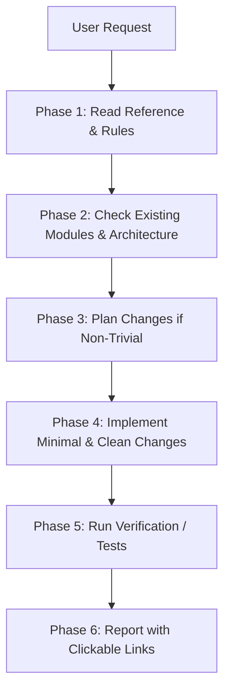

<!-- BEGIN:nextjs-agent-rules -->

# This is NOT the Next.js you know

This version has breaking changes — APIs, conventions, and file structure may all differ from your training data. Read the relevant guide in `node_modules/next/dist/docs/` (resolved from this file's directory; in monorepos the `next` package may not be visible from the repo root) before writing any code. Heed deprecation notices.

This block is written and re-added by `next dev` — verify at `node_modules/next/dist/server/lib/generate-agent-files.js`. Removing it from a diff only re-creates the uncommitted change; committing it with your work keeps the tree clean.

<!-- END:nextjs-agent-rules -->

# AGENTS.md - Multi-Agent Operating Guidelines

> **Project:** `ncf-sports-recommender` (KADY Sports Store & NCF Recommendation Engine)  
> **Audience:** ChatGPT, OpenAI Codex, Antigravity IDE, Cursor, Copilot, and Autonomous Agents.  
> **Operating System:** Windows PowerShell | **Python Venv:** `backend/venv` | **Frontend:** Next.js 16 (App Router)

---

## 1. Core System Architecture

1. **Backend Service (`backend/`)**:
   - **Framework:** Python **FastAPI** 0.112+ running on `http://localhost:8000`.
   - **Database:** **MongoDB** (Port 27017, database: `ncf_recommender_db`), accessed asynchronously via **Motor** & **Beanie ODM**.
   - **Recommendation Engine:** PyTorch Neural Collaborative Filtering (`app/ml/ncf_model.py`), merging GMF 16D and MLP 16D embeddings (32D vector) with MLP layers `[32, 16, 8]`. Weights saved at `app/ml/saved_models/ncf_weights.pth` and evaluated in `app/ml/training_metrics.json`.
   - **DO NOT** attempt to use MySQL, Prisma, or Drizzle ORM. Any reference in old markdown notes (`README1.md`) is legacy documentation.

2. **Frontend Service (`frontend/`)**:
   - **Framework:** **Next.js 16.3.5** (React 19.2+, App Router) running on `http://localhost:3000`.
   - **Styling:** **Tailwind CSS v4** + **Mantine UI v9**.
   - **State Stores:** **Zustand v5** in `frontend/src/shared/store/`.
   - **Architecture:** Clean Modular Domain layout in `frontend/src/modules/` (`public`, `admin`, `user`).

---

## 2. Agent Execution Workflow (Step-by-Step)

Before modifying or writing any code, all agents must follow this structured flow:

### Step 1: Reference Lookup
- Inspect rules in `.claude/rules/` (`architecture.md`, `code-style.md`, `security.md`).
- Inspect API contracts in `.claude/reference/api-contracts.md` and schema in `.claude/reference/database-schema.md`.
- Never guess API endpoints, schema fields, or model parameters.

### Step 2: Safe Implementation
- **Preserve Existing Comments & Docstrings:** Do not strip comments from unaffected code.
- **Next.js 16 Rules:** `params` and `searchParams` are async Promises (`const { id } = await params`).
- **No Duplicate Recommendations:** Every recommendation pipeline must call `_filter_duplicate_recs` in `recommendation_service.py` to prevent cloned products or duplicated image URLs.
- **Image Safety:** Every `` tag in frontend must include an `onError` fallback to a valid sports image.

### Step 3: Verification & Definition of Done (DoD)
A task is **DONE** only when:
1. Code contains no syntax errors or unhandled promise rejections.
2. The affected endpoint or component is verified via script, curl, or dev server check.
3. No breaking changes or regressions introduced in related modules.
4. Response to user contains accurate, clickable markdown links to affected files.

---

## 3. Directory & File Reference Index

| Mục tiêu | Vị trí tài liệu |
|---|---|
| Quy chuẩn kiến trúc | [`.claude/rules/architecture.md`](file:///d:/Projects/ncf-sports-recommender/.claude/rules/architecture.md) |
| Quy chuẩn code & style | [`.claude/rules/code-style.md`](file:///d:/Projects/ncf-sports-recommender/.claude/rules/code-style.md) |
| Bảo mật & Dữ liệu nhạy cảm | [`.claude/rules/security.md`](file:///d:/Projects/ncf-sports-recommender/.claude/rules/security.md) |
| Hợp đồng API RESTful | [`.claude/reference/api-contracts.md`](file:///d:/Projects/ncf-sports-recommender/.claude/reference/api-contracts.md) |
| Mô hình Cơ sở Dữ liệu MongoDB | [`.claude/reference/database-schema.md`](file:///d:/Projects/ncf-sports-recommender/.claude/reference/database-schema.md) |
| Pipeline Gợi ý NCF & Fallbacks | [`.claude/reference/recommendation-pipeline.md`](file:///d:/Projects/ncf-sports-recommender/.claude/reference/recommendation-pipeline.md) |
| Mẫu lập kế hoạch tính năng | [`.claude/plans/templates/feature-plan.md`](file:///d:/Projects/ncf-sports-recommender/.claude/plans/templates/feature-plan.md) |

---

## 4. Forbidden Actions for AI Agents

1. **DO NOT** wipe or re-seed the MongoDB database without explicit user confirmation.
2. **DO NOT** add relational database packages (prisma, drizzle, mysql2, pg) into this project.
3. **DO NOT** create dummy products with fake non-existent Unsplash IDs that result in 404 images.
4. **DO NOT** claim testing passed without executing the test commands.
5. **DO NOT** delete the `<!-- BEGIN:nextjs-agent-rules -->` block at the top of this file.
