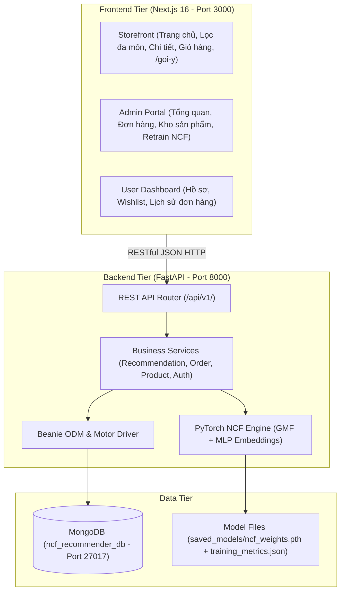

# KADY Sports Store & NCF Recommendation System

> **Đề tài:** Nền tảng thương mại điện tử chuyên đồ thể thao thông minh tích hợp hệ thống gợi ý mạng nơ-ron lọc cộng tác (Neural Collaborative Filtering - NCF).  
> **Sinh viên thực hiện:** Thạch Lý Na (MSSV: B2205891)  
> **Kiến trúc:** Decoupled Monorepo (Next.js 16 App Router Frontend + FastAPI Python MongoDB Backend)

---

## 1. Giới thiệu Dự án

**KADY Sports** là nền tảng thương mại điện tử chuyên nghiệp cung cấp trang thiết bị, trang phục, giày và phụ kiện thi đấu cho 7 bộ môn thể thao trọng điểm: **Bóng đá, Cầu lông, Bóng chuyền, Pickleball, Chạy bộ, Dã ngoại và Gym / Đa dụng**.

Hệ thống tích hợp công cụ AI gợi ý cá nhân hóa sâu:
* **Neural Collaborative Filtering (NCF):** Mô hình Deep Learning kết hợp **GMF (Generalized Matrix Factorization)** và **MLP (Multi-Layer Perceptron)** trên PyTorch với vector nhúng 32 chiều ($16 + 16$).
* **Real-time Basket Cross-sell:** Tính toán tương đồng Cosine theo thời gian thực giữa vector trung bình của giỏ hàng với toàn bộ kho hàng để gợi ý phụ kiện bán kèm phù hợp nhất.
* **Context-Aware Cold-Start Engine:** Giải thuật tính điểm đa tiêu chí (Rating, độ phổ biến, môn thể thao, jitter tạo độ tươi mới) cho khách hàng mới hoặc khách vãng lai chưa có lịch sử mua sắm.
* **Bộ lọc độc bản (Deduplication Guarantee):** Đảm bảo không trùng lặp hình ảnh hoặc biến thể sản phẩm trong danh sách gợi ý.

---

## 2. Công nghệ Cốt lõi (Tech Stack)

### Frontend Service (`frontend/`)
* **Framework:** Next.js 16.3.5 (React 19.2+, App Router, Server & Client Components)
* **Styling:** Tailwind CSS v4, Mantine UI v9 (`@mantine/core`, `@mantine/notifications`)
* **State Management:** Zustand v5 (`cartStore`, `authStore`, `wishlistStore`, `checkoutStore`)
* **Biểu đồ & Icons:** Recharts v3, Lucide React, React Icons

### Backend Service (`backend/`)
* **Framework:** Python FastAPI 0.112+, ASGI Uvicorn 0.30+
* **Database & ODM:** MongoDB 7.0+ (`ncf_recommender_db`), Motor 3.5+ & Beanie ODM 1.26+
* **Machine Learning:** PyTorch (`torch.nn`), NumPy, Pandas, Scikit-learn
* **Bảo mật & Giới hạn:** SlowAPI, JWT Authentication, Bcrypt Password Hashing

---

## 3. Kiến trúc Hệ thống (System Architecture)



---

## 4. Hướng dẫn Cài đặt & Khởi chạy (Quick Start)

### Yêu cầu Tiên quyết
* **Node.js:** 20.x hoặc 22.x LTS
* **Python:** 3.10, 3.11 hoặc 3.12/3.14
* **MongoDB:** Đang chạy tại `mongodb://localhost:27017`

### Bước 1: Khởi động Backend
```powershell
cd d:\Projects\ncf-sports-recommender\backend

# Kích hoạt virtual environment
.\venv\Scripts\Activate.ps1

# Cài đặt thư viện (nếu lần đầu)
pip install -r requirements.txt

# Khởi chạy server FastAPI
uvicorn app.main:app --reload --host 0.0.0.0 --port 8000
```
*Tài liệu API Swagger có sẵn tại: `http://localhost:8000/docs`.*

### Bước 2: Khởi động Frontend
```powershell
cd d:\Projects\ncf-sports-recommender\frontend

# Cài đặt dependencies (nếu lần đầu)
npm install

# Khởi chạy dev server Next.js 16
npm run dev
```
*Truy cập ứng dụng web tại: `http://localhost:3000`.*

### Bước 3: Huấn luyện lại mô hình NCF (Tùy chọn)
```powershell
cd d:\Projects\ncf-sports-recommender\backend
.\venv\Scripts\Activate.ps1
python scripts/train_ncf.py
```

---

## 5. Tài liệu Kỹ thuật & Quản trị

| Tài liệu | Đường dẫn |
|---|---|
| **AI Operating System** | [`CLAUDE.md`](file:///d:/Projects/ncf-sports-recommender/CLAUDE.md) \| [`AGENTS.md`](file:///d:/Projects/ncf-sports-recommender/AGENTS.md) |
| **Quy chuẩn Kiến trúc** | [`.claude/rules/architecture.md`](file:///d:/Projects/ncf-sports-recommender/.claude/rules/architecture.md) |
| **Hợp đồng REST API** | [`.claude/reference/api-contracts.md`](file:///d:/Projects/ncf-sports-recommender/.claude/reference/api-contracts.md) |
| **Lược đồ MongoDB** | [`.claude/reference/database-schema.md`](file:///d:/Projects/ncf-sports-recommender/.claude/reference/database-schema.md) |
| **Thuật toán Gợi ý NCF** | [`.claude/reference/recommendation-pipeline.md`](file:///d:/Projects/ncf-sports-recommender/.claude/reference/recommendation-pipeline.md) |
| **Quy trình Phát triển** | [`docs/guides/development-workflow.md`](file:///d:/Projects/ncf-sports-recommender/docs/guides/development-workflow.md) |
| **Phạm vi Luận văn** | [`docs/requirements/thesis-scope.md`](file:///d:/Projects/ncf-sports-recommender/docs/requirements/thesis-scope.md) |
