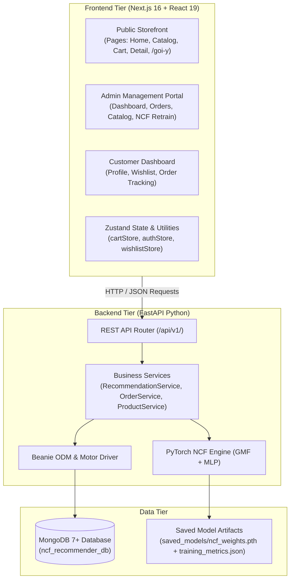

# System Architecture Overview

Tài liệu mô tả kiến trúc kỹ thuật của hệ thống **KADY Sports Recommender System**.

---

## 1. Mô hình Phân lớp Hệ thống (Layered Architecture)

Hệ thống được thiết kế theo mô hình phân lớp rõ ràng, đảm bảo tính độc lập và dễ dàng mở rộng:

---

## 2. Đặc tả các tầng kiến trúc

### A. Tầng Trình diễn (Presentation Tier - Next.js 16)
- **App Router:** Tận dụng kiến trúc định tuyến thư mục của Next.js 16 (`src/app/`).
- **Server Components:** Được ưu tiên tối đa cho các trang danh mục sản phẩm nhằm tối ưu hóa SEO và tốc độ tải trang lần đầu (First Contentful Paint).
- **Client Components:** Được kích hoạt có chọn lọc thông qua directive `'use client'` cho các tương tác giỏ hàng, modal thanh toán và lọc đa điều kiện.
- **Styling System:** Kết hợp giữa sự linh hoạt của **Tailwind CSS v4** và hệ thống component phong phú của **Mantine UI v9**.

### B. Tầng Nghiệp vụ (Business Logic Tier - FastAPI)
- **FastAPI Framework:** Cung cấp tốc độ xử lý I/O cao nhờ hỗ trợ bất đồng bộ `async/await` bản địa của Python.
- **Modular Services:** Mỗi miền nghiệp vụ được đóng gói trong một Service class riêng biệt (`ProductService`, `OrderService`, `RecommendationService`, `AuthService`, `AnalyticsService`).
- **Pydantic Validation:** Đảm bảo toàn vẹn dữ liệu đầu vào và tự động sinh tài liệu Swagger/OpenAPI tại `/api/v1/openapi.json`.

### C. Tầng Học máy (Machine Learning Tier - PyTorch NCF)
- Mô hình **Neural Collaborative Filtering (NCF)** tích hợp trực tiếp trong backend service (`app/ml/ncf_model.py`), chia sẻ bộ nhớ và trọng số đã huấn luyện (`saved_models/ncf_weights.pth`).
- **Kiến trúc NeuMF:** Kết hợp song song nhánh tuyến tính GMF (Embedding 16D) và nhánh phi tuyến sâu MLP (Embedding 16D ghép thành vector 32D) đi qua 3 tầng ẩn phi tuyến ReLU `[32, 16, 8]`.
- **Cơ chế Hybrid & Cold-Start Fallback:** Tự động phát hiện người dùng mới hoặc sản phẩm mới để chuyển mượt sang gợi ý dựa trên ngữ cảnh bộ môn và độ tương đồng Cosine (với epsilon an toàn `+ 1e-8`).

### D. Tầng Dữ liệu (Persistence Tier - MongoDB & Beanie)
- Lưu trữ phi cấu trúc linh hoạt với đầy đủ **11 Collections** chuẩn hóa trong cơ sở dữ liệu `ncf_recommender_db`:
  1. `products`: Sản phẩm thể thao, danh mục phân cấp, giá bán và ma trận biến thể (size, color, stock).
  2. `users`: Tài khoản khách hàng, quản trị viên, thông tin giao hàng và sở thích thể thao cá nhân.
  3. `orders`: Bản ghi đơn đặt hàng, chi tiết sản phẩm, trạng thái xử lý, vận chuyển và thanh toán.
  4. `interactions`: Lịch sử tương tác người dùng - sản phẩm (`view`, `cart`, `wishlist`, `purchase`).
  5. `vouchers`: Mã giảm giá, điều kiện áp dụng, hạn sử dụng và số lượt đã sử dụng an toàn.
  6. `reviews`: Nhận xét và điểm số đánh giá 1-5 sao của khách hàng đối với từng sản phẩm.
  7. `banners`: Ảnh bìa và biểu ngữ quảng cáo cho các sự kiện flash-sale trên trang chủ.
  8. `mega_menus`: Cấu trúc cây danh mục điều hướng đa cấp (Sport Type -> Product Type -> Category).
  9. `product_attributes`: Bảng định nghĩa các thuộc tính chuẩn hóa (bộ môn, thương hiệu, chất liệu, kích thước).
  10. `recommendation_impressions`: Ghi nhận nhật ký hiển thị và click vào các đề xuất AI để đo lường CTR.
  11. `notifications`: Thông báo hệ thống và ưu đãi gửi tới từng tài khoản người dùng.
